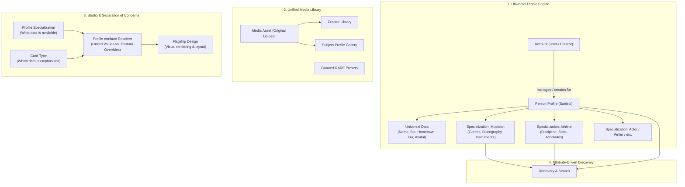
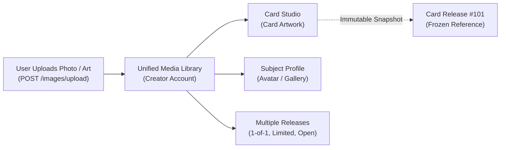

# RARE — Universal Profiles, Linked Content Engine & Unified Media Library
## Architectural Blueprint & Implementation Specification

> **Core Product Promise:** *Enter information once. Upload media once. Reuse both everywhere.*

---

## 1. Architectural Philosophy: The Three Pillars



---

## 2. Core Architectural Separation

| Concept | Responsibility | Driven By | Example |
| :--- | :--- | :--- | :--- |
| **Profile Specialization** | What structured information is available & where the person lives in discovery | Subject's real-world pursuits | *Musician* (discography, genre), *Athlete* (records, stats), *Writer* (bibliography) |
| **Card Type** | Which information is emphasized & what role the card plays | Narrative / collectible intent | *Achievement* (honors), *Event* (live date), *Profile* (identity), *Lore* (origin) |
| **Flagship Design** | Geometric layout, typography hierarchy, colors, decorations, and aesthetic tradition | Visual artistry & era | *Prestige Gold*, *Minimalist Swiss*, *Arcade '85*, *Sports Legend* |

---

## 3. Universal Profiles & Specialist Schemas

### 3.1 Universal Profile Schema
Every subject has universal identity data:
```typescript
export interface UniversalProfile {
  id: string
  slug: string
  displayName: string
  aliases?: string[]
  bio?: string | null
  hometown?: string | null
  originEra?: string | null
  avatarUrl?: string | null
  claimedByUserId?: string | null
  specializations: ProfileSpecializationData[]
  mediaAssetIds: string[]
}
```

### 3.2 Modular Specializations
A subject can carry **multiple specializations** without separate accounts or fragmented profiles:

1. **Athlete**
   - Discipline/Sport, Primary Role/Position, Teams/Organizations, Career Milestones, Statistical Highlights, Championship Accolades, Era/Years Active.
   - *Adapter:* Seamlessly maps existing `AthleteProfile`, `Player`, and `Sport` entities.
2. **Musician**
   - Musical Genres, Primary Instruments, Discography (Key Releases/Albums), Record Labels, Tour/Live Milestones, Associated Acts / Collaborators.
3. **Actor / Performer**
   - Medium (Film, Theatre, Television, Voice), Signature Roles, Notable Productions, Accolades/Nominations, Representation/Guilds.
4. **Writer / Author**
   - Literary Genres, Bibliography (Published Works, Serials), Publications/Periodicals, Literary Honors, Themes/Movements.
5. **Creator / Producer**
   - Creative Domains (Design, Podcasting, Video, Art Direction), Studios/Collectives, Channels/Platforms, Flagship Works.
6. **Scientist / Scholar**
   - Academic Field, Research Focus, Institutional Affiliations, Key Discoveries/Theories, Major Citations/Honors.
7. **Model / Fashion**
   - Runway / Editorial, Representation/Agencies, Signature Campaigns, Fashion Houses.
8. **Cultural / Historical Figure**
   - Epoch/Movement, Historical Impact, Key Chronicles/Speeches, Archives & Provenance.

---

## 4. Linked Content Values & Overrides

### 4.1 Linked Field Model
Each card field in the Studio can be linked to a structured profile attribute or contain a custom text override:

```typescript
export interface LinkedCardField {
  slotId: string              // e.g. 'input1', 'input2', 'input3'
  fieldId: string             // CardType field ID, e.g. 'headline', 'milestone'
  label: string
  sourcePath?: string         // e.g. 'profile.displayName' or 'specialization.athlete.milestone'
  linkedValue: string         // Dynamically resolved from profile
  overrideValue?: string      // Custom override entered by creator
  isLinked: boolean           // True if synchronized with profile; False if overridden
}
```

### 4.2 Behavior
- **Sync by Default:** When a Person Profile is selected, card fields automatically link to the profile's universal attributes or relevant specialization values.
- **Creator Overrides:** If the creator edits a linked field in the Studio, the field transitions to `isLinked: false` with the custom `overrideValue`.
- **Re-link Action:** Creators can click a *Link* icon to revert an override and re-synchronize with the profile at any time.
- **Profile Independence:** Updating card fields never overwrites or corrupts the master Person Profile.

---

## 5. Unified Media Library

### 5.1 "Upload Once, Reuse Everywhere"



### 5.2 Media Library Selector
The Card Studio Artwork Selector presents four coordinated sources:
1. **Curated Presets:** Built-in cultural, historical, athletic, and sci-fi presets (`CURATED_ARTWORKS`).
2. **User Library:** All assets previously uploaded by the creator account across all sessions and cards.
3. **Subject Profile Gallery:** Media specifically associated with the selected Person Profile.
4. **Upload New:** Native upload button attaching new assets to the user's library and immediately selecting them for the card.

### 5.3 Release Immutability
When a release is created (`POST /releases`):
- `sourceImageAssetId` binds the specific asset permanently.
- The composition snapshot is frozen at release time.
- Later additions or reorganization in the user's media library never alter published releases.

---

## 6. Attribute-Driven Discovery

User attributes and specializations become the backbone of browsing and categorization:
1. **Category Navigation:** Faceted filtering by specialization (`Musicians`, `Athletes`, `Writers`, `Creators`, `Actors`).
2. **Sub-discipline Filtering:** Drilldown into genres, sports, or mediums (e.g. `Musicians > Jazz`, `Athletes > Track & Field`).
3. **Cross-Pursuit Discovery:** Multi-specialist figures surface naturally across all relevant categories (e.g. an athlete-author appears in both Athletics and Literature).
4. **Related Entities:** Discover cards by shared collaborators, teams, movements, or eras.

---

## 7. Implementation Roadmap

### Phase P0: Data Foundation & Studio Integration
- [ ] **Profile Taxonomy Schemas (`profileTaxonomy.ts`)**: Universal profile interface + 8 specialized extension schemas + multi-specialization data structure.
- [ ] **Sports Legacy Adapter (`sportsAdapter.ts`)**: Map existing `AthleteProfile`, `Player`, and `Sport` records into the `Athlete` specialization.
- [ ] **Attribute Resolver (`profileAttributeResolver.ts`)**: Map Card Type fields to profile attributes; manage linked values vs. local overrides.
- [ ] **Unified Media Library Hook (`useMediaLibrary.ts`)**: Aggregate user-uploaded images, profile-associated media, and curated presets with cache preservation.
- [ ] **Studio Integration**:
  - Person Selector linked to profile attributes.
  - Link/unlink toggle per content field.
  - Full Media Library selector drawer in Card Studio.

### Phase P1: Discovery & Profile Browsing
- [ ] **Specialist Discovery Filtering**: Faceted category browsing in `DiscoverScreen`.
- [ ] **Unified Profile Page**: Public profile showing universal data, specialist accolades, media gallery, and published card releases.
